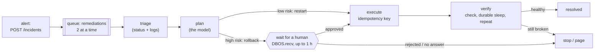

# durable-agent

An incident-remediation agent run that survives crashes. Each run is a [DBOS](https://github.com/dbos-inc/dbos-transact-py) durable workflow on PostgreSQL: kill the worker at any point, start another, and the run carries on from its last finished step, without repeating work it already did.

Python 3.12 · DBOS Transact 3.6 · PostgreSQL 16 · FastAPI. Personal learning project, built pairing with Claude Code. The "model" is a scripted stand-in and the infrastructure it fixes is a fake ops API; no real model or cluster is involved.

## What a run does



Every box is a step DBOS records in PostgreSQL. If the worker dies anywhere, a new worker re-runs the workflow function and each finished step returns its recorded result instead of running again.

## What the tests prove

All against real worker processes, each test on its own fresh database:

| Situation | Result |
|---|---|
| worker killed between steps | a new worker finishes the run; triage is not repeated (logs read once) |
| worker killed inside the step that applies the fix, **no** idempotency key | the fix is applied **twice**: steps are at-least-once |
| the same, **with** an idempotency key | applied once; the retry gets the first reply back |
| worker killed while waiting for approval | a new worker resumes the wait; the approval still lands |
| approval sent while **no** worker is running | the message waits in PostgreSQL and is delivered later |
| the same alert twice | one run (the incident ID is the workflow ID) |
| four broken services at once | all fixed, never more than two runs active |
| a planner bug sends the wrong fix | after the fix, the run is forked from its planning step: triage reused, the right fix applied |

## Try it

```bash
python -m venv .venv && .venv/Scripts/pip install -e ".[dev]"   # or: uv pip install
python scripts/demo.py     # fake ops API, worker, operator API; kills the worker mid-run
python -m pytest           # 15 tests, about 2.5 minutes; needs PostgreSQL (TEST_PG, default 127.0.0.1:5433)
```

`scripts/demo.py` output, abridged (run on this laptop):

```text
> an alert opens incident inc-900
plan: {'action': 'rollback', 'to_version': 'v41', 'risk': 'high', ...}
> the worker is killed while the run waits for a human
> a new worker starts
stage: awaiting_approval
> asha approves the rollback
outcome: resolved
actions: [{'n': 1, 'kind': 'rollback', ..., 'idempotency_key': 'inc-900:execute'}]
```

## Durable execution, and what it doesn't do

- **Exactly-once workflow, at-least-once steps.** A finished step never runs again. A step that was *running* when the process died runs again. So every step with an outside effect sends an idempotency key, and the other side must honour it. The fake ops API does; a real API might not.
- **The workflow function must be deterministic.** It's re-run from the top on recovery. Anything that varies (time, randomness, network, a model) belongs in a step, whose result is recorded.
- **Changing code under running workflows** is a versioning problem. DBOS tags runs with an application version and recovers each on a matching version; forking onto a new version is the escape hatch.
- **Alternatives:** Temporal (a separate cluster, more features, more to run), AWS Step Functions (managed, JSON state machines), queue + cron + retries (what most teams have, which is where "did that restart happen twice?" bugs come from). DBOS keeps the state in the PostgreSQL you already run, as a library.

## Build log

### Step 1: the workflow and its normal paths

- `runbook.py`: one DBOS workflow, `remediate`. Steps: triage (read status and logs) → plan → (approval if risky) → execute → verify with durable sleeps between checks → report. Its progress is published as a DBOS event (`stage`) so anything outside can see where a run is.
- `fakeops.py`: a FastAPI app standing in for the outside world (a service API and a pager). It counts every read and action and supports idempotency keys, so tests can prove exactly what happened.
- `planner.py`: the "model". A scripted stand-in that reads the same signals an LLM would and answers in the same shape, so tests measure the workflow, not a model. Low-risk fixes (restart) run straight away; high-risk ones (rollback) wait for a human.
- `worker.py`: the process that runs workflows from the `remediations` queue.

Tests run against **real worker processes** and a fresh PostgreSQL database each (the local test cluster on port 5433): a low-risk fix with no approval, a rollback that waits for a human, a rejected fix, nobody answering (pages after the timeout), the same incident ID enqueued twice (one run, logs read once), and a healthy service.

What broke: DBOS 3 no longer lets you construct `Queue(...)` directly. Queues are stored in the system database now, registered with `DBOS.register_queue` after `DBOS.launch()`.

### Step 2: crashes

`CRASH_AT` makes the worker exit with `os._exit(137)` at a named point: no cleanup, no `finally`, the same as `kill -9` or a node dying. A new worker process then starts on the same database.

| Crash | What the test proves |
|---|---|
| between triage and planning | the new worker finishes the run, and triage is **not** repeated (the fake API saw the logs read exactly once) |
| inside the execute step, after the API call, **no idempotency key** | the restart is applied **twice**. A step that was running when the process died runs again: steps are at-least-once |
| the same, **with** an idempotency key (`<run id>:execute`) | applied once; the retry gets the first reply back, marked `replayed` |
| right after the execute step finished | applied once even without a key: a finished step never runs again |
| while waiting for approval (worker killed) | a new worker picks up the wait; the approval is accepted and the run finishes |
| approval sent while no worker is running at all | the message waits in PostgreSQL and is delivered when a worker starts |

The third and fourth rows are the lesson: durable execution makes the *workflow* exactly-once, but a step that dies halfway is retried, so any step with an outside effect needs an idempotency key that the other side honours.

What broke: nothing; all six passed on the first run.

### Step 3: operating it

- `api.py`: the operator API (FastAPI). It never runs a workflow; it talks to PostgreSQL through `DBOSClient`, so it can restart or scale apart from the workers. `POST /incidents` (the incident ID becomes the workflow ID, so a repeated alert attaches to the existing run), `GET /incidents`, `GET /incidents/{id}` (status, stage, plan, result), `POST …/approve` and `…/reject` (refused with 409 unless the run is actually waiting), `GET …/steps`, `POST …/fork`.
- **Queue limit:** runs go through the `remediations` queue with `global_concurrency=2`. Test: four broken services at once, all four resolved, and the fake API saw at most two runs active at a time (and it did see two, so they really ran in parallel).
- **Fork:** a planner bug (switched on with `PLANNER_BUG=always_restart`) makes the agent restart a service that needed a rollback; the run ends `not_fixed` and pages. With the bug fixed, `POST /incidents/inc-320/fork {"from_step": "make_plan"}` starts a new run that reuses the original triage result (the logs were read once in total) and re-runs planning onwards: rollback, approval, resolved.

The bug is switched by an environment variable so the code, and so DBOS's application version, stays the same. After a real code fix you'd fork onto the new version (`fork_workflow(..., application_version=...)`).

The full suite (15 tests, each with real worker processes and its own database) takes about 2 min 40 s here and leaves no databases or processes behind.

### Step 4: demo script and docs

`scripts/demo.py` runs the fake ops API, a worker and the operator API as separate processes on ports 8095–8096, breaks a service, opens an incident, kills the worker while the run waits for approval, starts a new worker, approves, and prints the outcome, what the outside world saw, and the run's recorded steps. On Windows a killed process exits with code 1 (TerminateProcess), not 137. Then this README and `LEARN.md`.

Where it stands: 4 local commits, 15 tests passing, demo verified on this laptop. Not published; no real model calls.
